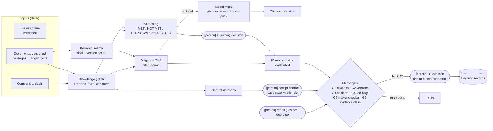

# Architecture and data flow

Synthetic data, illustrative policies. Human decision points are marked **[person]**.

## Components

| Module | Role |
|---|---|
| `data.py` | Loads documents, passages, facts; live-version logic by as-of date; line-ending-independent fingerprints |
| `graph.py` | Nodes and edges; version diff, evidence changes, comparables, claims on conflicts, fact lineage |
| `conflicts.py` | Live sources disagreeing on the same company, metric and period (stable conflict IDs) |
| `screening.py` | Criterion status with evidence; screening outcome; shows the recorded human decision |
| `search.py` | BM25 over the deal's live passages |
| `qa.py` | Cited answers (SUPPORTED, CONFLICTED, CHANGED, INSUFFICIENT); citation validator |
| `llm.py` | Optional model mode: evidence pack, structured output, citation validation, cost cap |
| `memo.py` | Memo rendering, six-check gate, memo fingerprint, IC decision checks |
| `evaluate.py` | Prototype evaluation, measures reported separately and per question |
| `value.py` | Hours estimate with range and assumptions; quality and adoption measures |
| `dashboard.py` | Static HTML built from the same functions |

## What would need validation before real use

- Extraction of facts from real documents, with human confirmation and an error rate.
- A held-out evaluation set written by deal professionals, and spot checks of citation support.
- Access control, data-room permissions and information barriers between deal teams.
- Retention, audit and model-risk review of the model mode; the cost cap and provider terms.
- The screening criteria, conflict rules and gate checks set and approved by the investment team.
